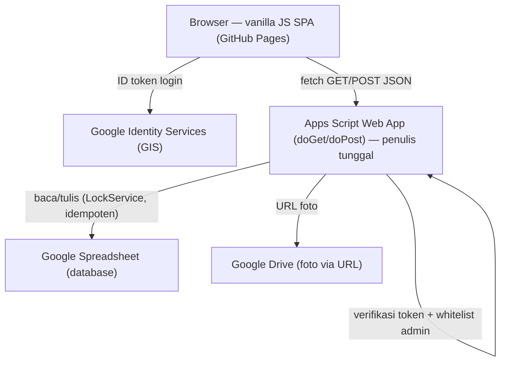
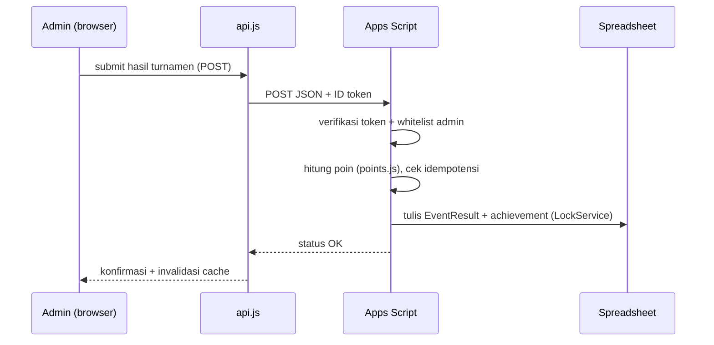
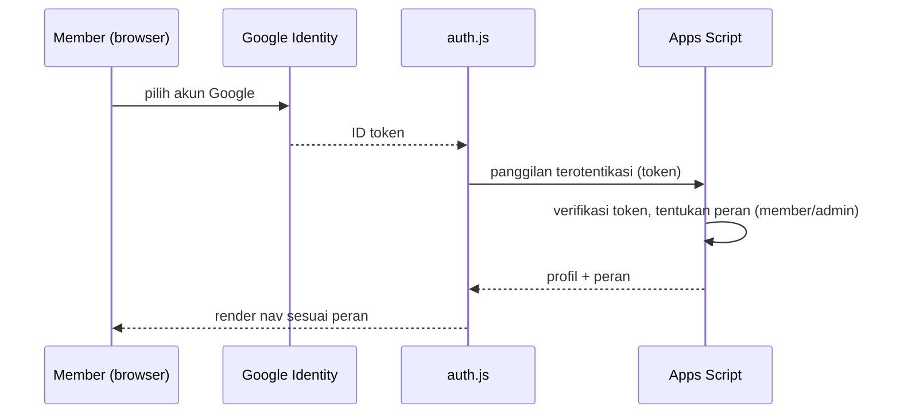

# Architecture

## System Overview
Front-end statis (vanilla JS SPA) dihosting di GitHub Pages, berkomunikasi lewat HTTP JSON dengan sebuah Google Apps Script Web App yang menjadi **penulis tunggal** ke Google Spreadsheet (database) dan Google Drive (foto via URL). Autentikasi member memakai Google Identity Services (GIS) di klien; otorisasi dan validasi kepemilikan data dilakukan server-side di Apps Script.

## Architectural Style
**Serverless/BaaS-style hybrid** dengan bukti:
- Tidak ada server aplikasi yang dikelola sendiri; backend = Apps Script Web App (`apps-script/Code.gs`, `doGet`/`doPost`).
- Front-end murni statis tanpa build step (script klasik, bukan ES module) — `docs/index.html`.
- Datastore = Google Spreadsheet, diakses hanya lewat Apps Script (invariant "penulis tunggal").

## Component Relationships

Teks fallback: Browser login ke GIS untuk ID token, lalu memanggil Apps Script via fetch JSON. Apps Script memverifikasi token & whitelist admin, lalu membaca/menulis Spreadsheet (dengan LockService, idempoten) dan mereferensikan foto di Drive.

## Data Flow
1. Klien memuat shell `docs/index.html`, router hash menentukan halaman.
2. Modul halaman memanggil `docs/js/api.js` → `fetch` ke `GAS_WEBAPP_URL` (`docs/config.js`).
3. Hasil read di-cache di sisi klien (`docs/js/cache.js`) untuk hemat kuota.
4. Operasi tulis (daftar event, input poin, approval) dikirim POST; Apps Script memvalidasi, menulis Sheets secara idempoten, mencatat achievement otomatis untuk pemenang.

## Key Design Decisions
- **Penulis tunggal Apps Script** — mencegah korupsi data dari banyak jalur tulis.
- **Otorisasi server-side** — klien tidak dipercaya untuk klaim admin.
- **Script klasik (non-module)** — agar `index.html` jalan langsung dari `file://` dan GitHub Pages tanpa bundler.
- **Cache klien** — mengurangi beban kuota Apps Script/Sheets.

## Improvement Opportunities
- Stylesheet front-end terpusat dalam satu `docs/styles.css` besar; referensi `template/css/` modular per-section bisa jadi pola yang lebih rapi (relevan untuk intent re-skin ini).
- Dua bahasa visual (`docs/` vs `template/`) belum selaras — target intent aktif.

## Interaction Diagrams

### Input poin leaderboard oleh admin

Teks fallback: Admin submit hasil → api.js POST ke Apps Script dengan token → Apps Script verifikasi admin, hitung poin via points.js, tulis EventResult + achievement secara idempoten dengan LockService, balas OK.

### Login member

Teks fallback: Member login lewat GIS → auth.js menerima ID token → Apps Script memverifikasi token dan menentukan peran → nav dirender sesuai peran.
