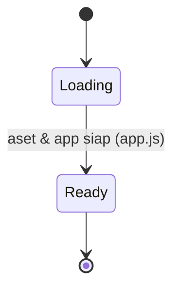

# Functional Spec — UI Re-skin (Beysic)

Unit UI-only. Dokumen ini self-contained: menspesifikasikan bahasa visual target, pemetaan design-token → komponen, struktur CSS modular, dan transisi state visual. Tidak ada entity/business-rule domain baru (lihat `entities.md`, `rules.md`).

## 1. Design Tokens (sumber: `template/css/base.css`)

| Token | Nilai | Peran |
|---|---|---|
| `--bg` | `#070b12` | Latar halaman |
| `--panel` | `#0d1420` | Permukaan panel |
| `--panel2` | `#111c2b` | Permukaan panel sekunder |
| `--blue` | `#1676e8` | Aksen primer |
| `--cyan` | `#42f3ff` | Aksen sekunder (menggantikan kuning lama) |
| `--white` | `#f4f8ff` | Teks utama |
| `--muted` | `#9caec4` | Teks sekunder |
| `--line` | `rgba(126,178,224,.18)` | Garis/border |
| `--radius` | `18px` | Radius sudut |
| `--max` | `1180px` | Lebar maksimum konten |
| Font | `Inter` (Google Fonts CDN) | Tipografi (menggantikan Oswald/Barlow) |

Latar global: lapisan `radial-gradient` biru+cyan + grid halus (pola `body:before` template). Heading memakai `.gradient` (teks gradient). Label kecil memakai `.eyebrow` (cyan, uppercase, letter-spacing, garis pendek).

## 2. Struktur CSS Modular Target (BR1.5)

File di bawah `docs/css/`, dimuat berurutan di `docs/index.html` (`responsive.css` terakhir):

```
base.css         token :root, reset, tipografi Inter, .container, .eyebrow, .gradient, latar grid
buttons.css      .btn, .btn-primary, .btn-ghost, .full
layout.css       .section, .section-head, .section-alt, .app-main
header.css       topbar, brand/logo, nav, tombol menu mobile, auth-area
hero.css         hero home (heading .gradient, tata letak hero) + animasi bila ada
footer.css       footer, tagline, back-to-top, kredit
components.css   .card, .iconbox, .tag, .muted-note, .leader-controls, popup alert, loader
leaderboard.css  pencarian + tabel peringkat
events.css       daftar event + form pendaftaran
membership.css   kartu paket + form signup
profile.css      kartu profil, foto, deck, achievement, form edit
admin.css        panel admin, form input poin, approval
responsive.css   semua @media — dimuat PALING AKHIR
```

Catatan: pembagian mengikuti pola `template/css/`; file halaman yang tak relevan boleh digabung bila kecil, selama urutan & lokasi (`docs/`) terjaga.

## 3. Pemetaan Token → Komponen

- **Header/brand**: latar `--panel`, border bawah `--line`; brand memakai logo gambar (`docs/assets/`, dari `template/assets/images/`) menggantikan emoji 🐺; nav link `--muted` → `--white`/`--cyan` saat aktif/hover.
- **Nav mobile**: tombol toggle bergaya `.btn-ghost`.
- **Loader splash**: ikon logo yang sama + teks "BEYSIC"; warna aksen `--cyan`, latar `--bg` + grid (BR1.1, FR4.1, FR5.2).
- **Button**: `.btn-primary` (gradient biru), `.btn-ghost` (border `--line`, hover `--cyan`), radius 9px; dipakai untuk aksi utama (daftar event, submit, login).
- **Card**: `.card` (gradient panel, border `--line`, radius `--radius`, aksen lingkaran cyan) untuk kartu membership, info home, kartu profil.
- **Eyebrow/heading**: hero tiap halaman → H1/H2 dengan `.gradient`; label section → `.eyebrow` (BR1.4).
- **Tag/badge**: `.tag` (cyan) untuk penanda (status event, kategori).
- **Tabel leaderboard**: header & baris bergaya panel; `.leader-controls` untuk pencarian; aksen cyan untuk highlight (tanpa kuning).
- **Form (event/membership/profile/admin)**: input berlatar panel, border `--line`, fokus border `--cyan`.
- **Popup alert**: overlay gelap + panel `--panel`, aksen per jenis (info/success/warning/error) tetap, diselaraskan ke palet baru.

## 4. Workflow Re-skin (langkah penerapan)

1. Tambahkan font Inter (Google Fonts) + hapus link Oswald/Barlow di `index.html`.
2. Buat `docs/css/` modular; pindahkan & selaraskan aturan dari `styles.css` lama ke file per-bagian dengan token baru.
3. Perbarui urutan `<link>` di `index.html` (`responsive.css` terakhir); hapus `styles.css` lama setelah paritas tercapai.
4. Salin aset logo ke `docs/assets/`; ganti emoji brand (header) & loader dengan logo.
5. Selaraskan markup presentasional di `index.html` dan string template `docs/js/pages/*.js` (tambah class `.card`, `.eyebrow`, `.gradient`, `.section` di tempat wajib) tanpa mengubah logika/handler.
6. Tinjau aset Axio yang masih dipakai → perbarui footer + `CREDITS.md` (BR1.8).
7. Jalankan e2e + unit test; perbaiki selector bila markup berubah (BR1.6).

## 5. State Machine — Visual Loader



Teks fallback: Halaman mulai di state Loading (loader splash tampil), lalu transisi ke Ready saat app.js selesai inisialisasi (loader disembunyikan), tampil konten. Hanya warna/aset loader yang berubah; perilaku transisi sama persis seperti sekarang.

## 6. State Visual Link Navigasi

```mermaid
stateDiagram-v2
  [*] --> Default
  Default --> Hover: kursor di atas / fokus
  Hover --> Default: keluar
  Default --> Active: rute cocok
  Active --> Default: pindah rute
```

Teks fallback: Link nav punya tiga state visual — Default (`--muted`), Hover (`--white`), Active (`--cyan`/`--white`). Perilaku routing tidak berubah; hanya warna state yang mengikuti token baru.

## 7. Entity-Relationship (derived)

Tidak ada entity dalam unit ini (lihat `entities.md`). Tidak ada diagram ER untuk unit UI-only ini.

## 8. Rules Summary (derived dari `rules.md`)

BR1.1 token `:root` cocok · BR1.2 tanpa token lama · BR1.3 Inter · BR1.4 gradient/eyebrow · BR1.5 CSS modular · BR1.6 test hijau · BR1.7 kontras WCAG AA · BR1.8 logo & atribusi · BR1.9 latar grid/gradient · BR1.10 token di semua halaman+shell · BR1.11 logo brand header · BR1.12 markup tak ubah logika · BR1.13 responsif/paritas breakpoint · BR1.14 tanpa dependency baru, aset di `docs/`.

## 9. Non-Fungsional yang Mengikat
- Responsif 360px→desktop setara/lebih baik (NFR2.1) — paritas breakpoint `template/responsive.css`.
- Kontras WCAG AA sebagai target (NFR3.1 / BR1.7).
- Tanpa framework/build baru; aset di `docs/` (NFR4, NFR5).

## Assumptions & Open Questions
- Asumsi: aset logo tersedia di `template/assets/images/` dan boleh dipakai; bila terikat lisensi Axio, atribusi dipertahankan (BR1.8).
- Open question: pembagian file CSS per-halaman final menyesuaikan volume aturan nyata saat eksekusi (tetap mengikuti pola template).
